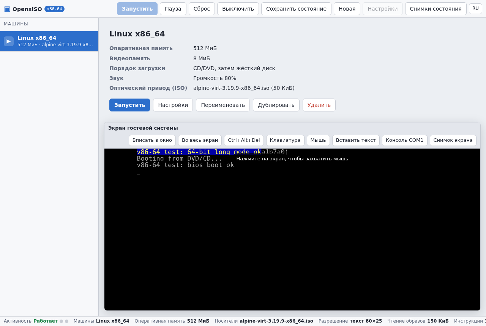
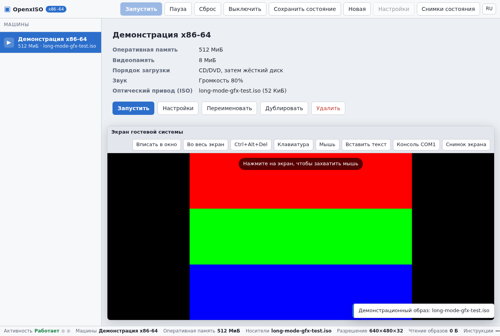
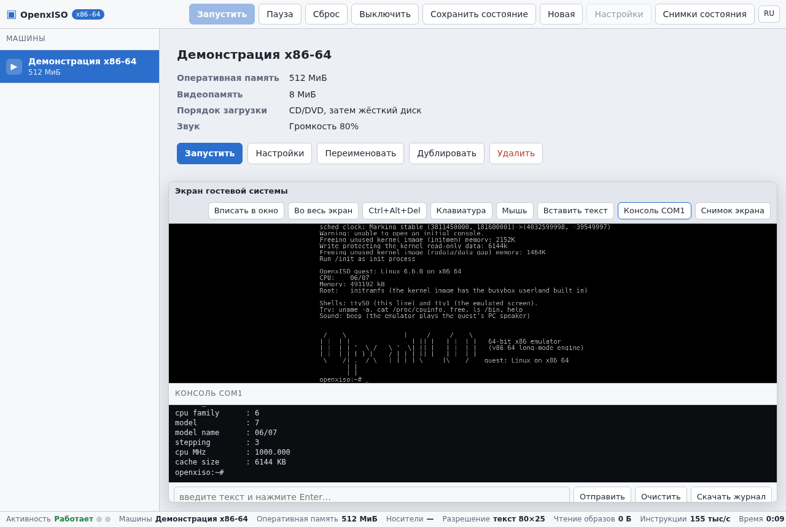
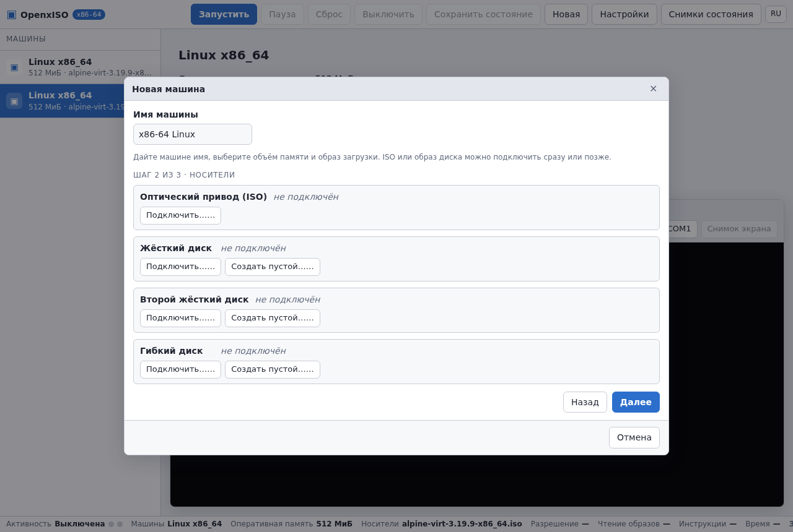
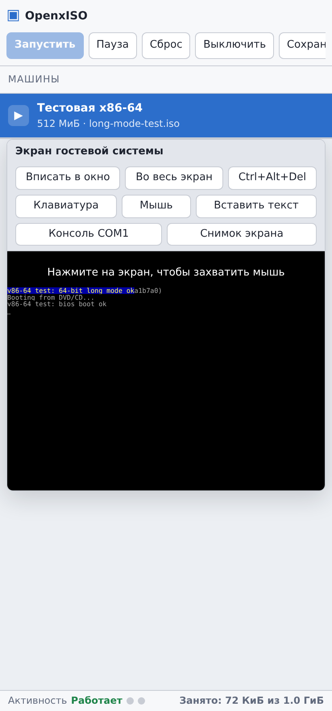

# OpenxISO — эмулятор x86-64 в браузере и на Android

Здесь лежит эмулятор персонального компьютера с поддержкой **64-битного
(длинного) режима процессора**. Он запускает настоящие операционные системы из
образов ISO и образов жёстких дисков, которые можно выбрать прямо из памяти
телефона или компьютера, и выглядит и управляется как VirtualBox: слева список
машин, сверху кнопки питания, экран гостевой системы в центре.

```
emulator/
├── index.html            страница приложения
├── css/app.css           оформление (светлая и тёмная темы, мобильная вёрстка)
├── js/
│   ├── app.js            машины, кнопки питания, мастер создания, снимки
│   ├── engine.js         обёртка над v86_64 (запуск, пауза, состояние, звук)
│   ├── machine.js        описание машины и её параметров
│   ├── media.js          BlobBuffer: чтение ISO/HDD из файла телефона
│   ├── store.js          IndexedDB: машины, образы, снимки состояния
│   ├── display.js        масштаб экрана, захват мыши, виртуальная мышь
│   ├── keyboard.js       скан-коды PC и экранная клавиатура для телефона
│   ├── serial.js         консоль COM1 (ANSI-последовательности, буфер)
│   ├── settings-ui.js    страницы свойств машины
│   ├── files.js          выбор файлов, перетаскивание, место в хранилище
│   ├── i18n.js           русский интерфейс (+ английские строки)
│   └── ui.js             диалоги, уведомления, элементы форм
├── vendor/v86_64/        движок: libv86.mjs, v86.wasm, BIOS (BSD-2-Clause)
├── images/               гостевой образ: настоящее ядро Linux 6.6 для x86-64
│                         с BusyBox внутри (собирается tools/linux-guest)
├── icons/                иконки приложения
├── manifest.webmanifest  установка как приложение
├── sw.js                 работа офлайн
├── serve.mjs             локальный сервер для запуска
├── tests/                тесты: юнит-, загрузочный и браузерный
└── README.md             этот файл
```

## Как запустить

```
node emulator/serve.mjs
# открыть http://localhost:8080/
```

Сервер отдаёт каталог `emulator/` и корень репозитория (чтобы были доступны
образы из `build/emulator-tests/`), понимает Range-запросы и отдаёт
`application/wasm`.

Дальше: **Новая** → выбрать память → **Подключить…** напротив «Оптический привод
(ISO)» → выбрать ISO-файл → **Создать**, затем **Запустить**. Экран можно
растянуть на весь экран кнопкой **Во весь экран**, появившееся окно станет
гостевым рабочим столом.

Если под рукой нет ISO, можно посмотреть на работу эмулятора на тестовом образе:

```
http://localhost:8080/emulator/index.html?demo=1     # 64-битный тестовый гость, COM1 и экран
http://localhost:8080/emulator/index.html?demo=gfx   # он же настраивает VBE 640x480x32
http://localhost:8080/emulator/index.html?demo=linux # настоящий Linux 6.6 x86-64, см. ниже
```

(сборка тестовых образов: `python3 emulator/tests/make_test_images.py`).

### Настоящая 64-битная система

`?demo=linux` создаёт машину, подключает к ней **образ ядра Linux** и включает
питание. Ехать никуда не нужно: `emulator/images/linux-6.6-x86_64.bzImage` —
это собранное из исходников ядро Linux 6.6 для x86-64 вместе со встроенным
BusyBox (`/init`, `sh`, `cat`, `uname`, `free`, `top`, `vi`, `grep`, `df`,
`dmesg`, `poweroff`) и `beep`. Движок загружает его по протоколу загрузки Linux,
поэтому ни BIOS, ни загрузочный сектор, ни образ диска не нужны — достаточно
файла ядра.

Что происходит дальше:

* на **экране** (текстовый режим VGA 80x25) идёт весь журнал загрузки ядра, а
  затем появляется приглашение оболочки — с клавиатуры можно печатать команды,
  нажатие на экран захватывает мышь, как в VirtualBox;
* в панели **«Консоль COM1»** та же система отвечает на команды, которые можно
  отправлять полем ввода, а весь вывод — сохранять кнопкой;
* команда `beep` в госте заставляет звучать PC Speaker: ядро программирует
  таймер 8253, эмулятор это слышит и играет тон через Web Audio.

Так же можно загрузить **любое другое ядро**: в свойствах машины у образа ядра
есть своя строка «Ядро Linux» (файлы `bzImage`, `vmlinuz`), а рядом — поле
«Параметры ядра» для командной строки. Образ ядра можно выбрать из памяти
телефона, перетащить в окно или подключить по ссылке.

Пересобрать образ ядра из исходников:

```
python3 tools/linux-guest/build.py    # Linux 6.6 + BusyBox 1.36.1, ~10 минут
```

## Как это выглядит



Слева список машин, сверху кнопки питания, в центре экран гостевой системы и
консоль COM1 с тем, что гость напечатал (`64-bit long mode`, счётчик прерываний
таймера и PS/2, `done`).



Тот же тестовый гость в графическом режиме: он сам настраивает Bochs VBE на
640x480x32 и рисует в линейный кадровый буфер; в строке состояния видно
`640x480x32`.



Настоящая 64-битная система: ядро Linux 6.6 для x86-64 с BusyBox, загруженное
движком по протоколу загрузки Linux из одного файла. В консоли COM1 — ответы
гостя на `uname -a` и `cat /proc/cpuinfo`, на экране — та же система на tty1.




Скриншоты сделаны автоматически (`node emulator/tests/make_screenshots.mjs`),
поэтому их можно пересобрать в любой момент.

## Что уже работает

| Возможность | Состояние |
| --- | --- |
| Загрузка ISO (CD/DVD) | работает, включая подключение на ходу |
| Загрузка образа жёсткого диска (.hdd, .img, .raw) | работает |
| Образы из памяти телефона | работает: системный выбор файла + копирование в IndexedDB |
| Образ по ссылке (https, Range-запросы) | работает: сервер отдаёт файл блоками, в память браузера он не попадает |
| 64-битные системы (длинный режим) | работает: настоящий Linux 6.6 x86-64 загружается и отвечает в приложении |
| Образ ядра Linux (bzImage, vmlinuz) | работает: файл ядра с командной строкой, без ISO и диска |
| Графика VBE (линейный кадровый буфер) | работает: гость сам настраивает 640x480x32 |
| Прерывания: таймер PIT, клавиатура и мышь PS/2 | проверено 64-битным гостем |
| Мышь: захват по клику, виртуальная для сенсорных экранов | работает |
| Звук: Sound Blaster 16 и PC Speaker | работает, регулятор громкости; настоящий Linux-гость пищит командой `beep` |
| Экранная клавиатура и вставка текста | работает |
| Консоль COM1 с отправкой команд | работает |
| Снимки состояния (память + устройства) | работает |
| Перетаскивание файла образа на окно | работает |
| Установка как приложение и запуск офлайн | работает (PWA) |
| Сеть в гостевой системе | только через внешний WebSocket-релей |

Что сознательно не поддерживается: несколько процессоров, больше 8 ГиБ памяти,
3D-ускорение, AVX/AVX-512. Это ограничения движка, а не приложения.

## Движок

Основа — форк [v86_64](https://github.com/portlandhodl/v86_64) (BSD-2-Clause),
который добавляет в v86 поддержку x86-64: длинный режим, REX-префиксы и 16
регистров общего назначения, четырёхуровневые таблицы страниц, NX/SMEP,
64-битный JIT в WebAssembly. Обычные 32-битные системы тоже работают.

Готовые файлы движка лежат в `emulator/vendor/v86_64/` (`BUILD_INFO.txt`
описывает, из какого коммита они собраны, и содержит контрольные суммы).
Пересобрать их можно workflow `.github/workflows/vendor-v86-64.yml` — он
запускается из вкладки Actions и коммитит движок в ветку `engine/v86_64`; для
сборки нужен Rust с целью `wasm32-unknown-unknown`, clang и Node.js, поэтому
готовые бинарники хранятся в репозитории.

Проверки целостности и происхождения движка выполняет
`python3 tools/check_emulator.py`.

Что именно проверено здесь: 64-битный режим, прерывания, ввод с PS/2 и
графический режим VBE подтверждены собственным тестовым гостем
(`tests/boot64.S`, см. раздел «Тесты»), а сама 64-битная система — настоящим
ядром Linux 6.6 из `emulator/images/linux-6.6-x86_64.bzImage`: оно собрано из
исходников (`tools/linux-guest/build.py`) и загружается в тесте до оболочки
BusyBox и обратно, с вводом команд через COM1 и через эмулируемую клавиатуру.
Образы дистрибутивов проверить при сборке не получается: у окружения сборки нет
доступа к зеркалам, а движок и его автор сообщают о загрузке Debian/Ubuntu в
длинном режиме.

## Тесты

```
python3 emulator/tests/make_test_images.py   # собрать тестовые образы
node emulator/tests/unit_test.mjs            # модули приложения (без браузера)
node emulator/tests/boot_test.mjs            # загрузка ISO и .hdd в движке
node emulator/tests/linux_test.mjs           # Linux 6.6: загрузка, оболочка, COM1, экран
node emulator/tests/ui_test.mjs              # интерфейс в настоящем браузере
node emulator/tests/linux_ui_test.mjs        # тот же Linux, но через приложение
node emulator/tests/vga_debug.mjs            # экран гостя против его видеопамяти
node emulator/tests/make_screenshots.mjs     # картинки для этого файла
```

Первый и второй тесты в списке (кроме `linux_ui_test.mjs`) идут в CI. Для
`linux_test.mjs` нужен образ ядра из `emulator/images/`, для `linux_ui_test.mjs`
и `ui_test.mjs` — ещё и puppeteer с Chrome (`CHROME_PATH`, `PUPPETEER_DIR`).

* `tests/boot64.S` — крошечная загрузочная программа, которая делает то же, что
  делает настоящая система при старте:
  * печатает через COM1, переходит в защищённый режим, строит четырёхуровневые
    таблицы страниц и входит в **длинный режим**;
  * считает 64-битную арифметику с REX-префиксами и регистрами r8-r15, пишет
    баннер в текстовый режим VGA и пищит PC Speaker;
  * ставит таблицу прерываний (IDT) с обработчиками исключений, перенастраивает
    контроллер прерываний, программирует таймер PIT на 100 Гц, включает
    клавиатуру и мышь PS/2 и печатает, сколько байтов от них пришло;
  * находит кадровый буфер видеокарты через PCI BAR, настраивает режим Bochs VBE
    640x480x32, рисует три цветные полосы и читает их обратно.
  Вариант с графикой собирается из того же файла (`-DWITH_GRAPHICS=1`).
* `tests/boot_test.mjs` грузит образ как ISO (El Torito), как .hdd (MBR + чтение
  секторов через int 13h) и графический вариант как ISO.
* `tests/vga_debug.mjs` показывает построчно, что нарисовано на экране, и что
  лежит в видеопамяти по адресу начала (CRTC start address), и падает, если они
  расходятся. Так проверено, что текстовый режим рисуется честно: Linux
  прокручивает консоль именно сменой этого адреса.
* `tests/ui_test.mjs` открывает приложение в headless Chrome, создаёт машину
  через мастер, подключает ISO через системный выбор файла, запускает её,
  щёлкает по экрану (захват мыши), нажимает клавишу и двигает мышь — гость
  должен получить прерывания от PS/2 и таймера, — проверяет вывод на экране и
  в COM1, звук, снимок состояния, затем подключает .hdd перетаскиванием и грузит
  его, стримит ISO по ссылке, рисует графический тест на экране (640x480, три
  полосы по цветам пикселей) и проверяет, что машина и образы переживают
  перезагрузку страницы.
  Требуется `npm install puppeteer` (или `CHROME_PATH` на существующий Chrome).

## Как это попадает в Android

Приложение в APK — та же самая веб-страница. Сборка копирует каталог
`emulator/` в `assets/emulator/` (см. `.github/workflows/main.yml`), а
`platform/android/java/com/cb4/EmulatorActivity.java` показывает её в WebView.
Страницу отдаёт `EmulatorServer.java` — маленький HTTP-сервер на
`127.0.0.1`, потому что от `file://` не работают WebAssembly-компиляция,
service worker и IndexedDB, где хранятся образы.

Выбор ISO или `.hdd` идёт через системный выбор файлов (в WebView это
`onShowFileChooser`), поэтому файлы можно брать из «Файлов», «Загрузок»,
карты памяти или USB-накопителя.

## Хранилище и приватность

Образы и снимки состояния остаются на устройстве: приложение складывает их в
IndexedDB браузера, ничего никуда не отправляется. При первом запуске
приложение просит браузер не вытеснять эти данные. Если места не хватает,
образ подключается «только на эту сессию» — об этом сообщается отдельно.
Экспорт образа вместе с изменениями гостя и снимков состояния — кнопками
«Сохранить на устройство».

## Лицензии

* движок в `vendor/v86_64/` — BSD-2-Clause (v86_64, форк v86), BIOS SeaBIOS —
  LGPLv3: тексты лежат рядом с файлами движка;
* остальной код приложения — под лицензией репозитория (`LICENSE`).
